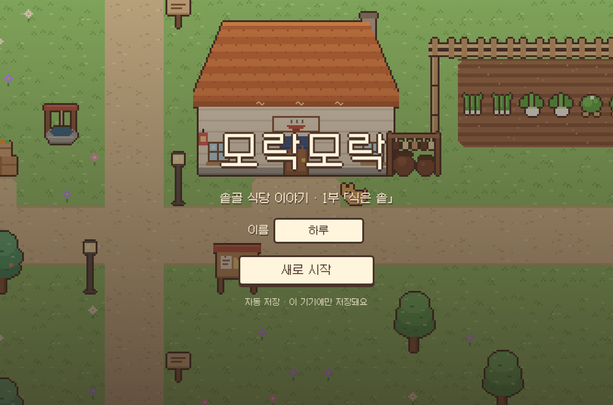
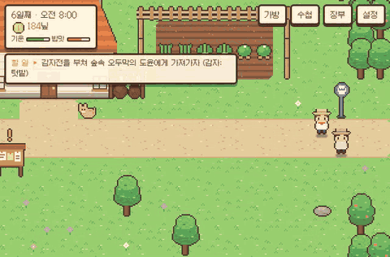
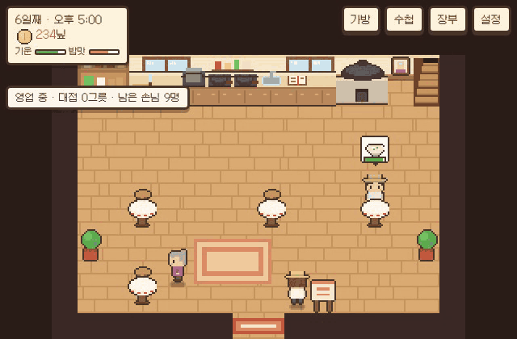
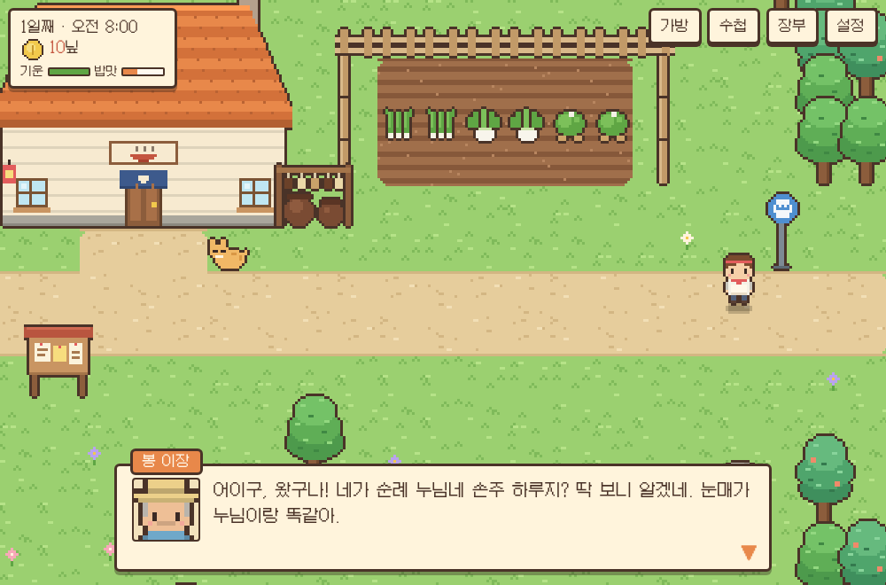
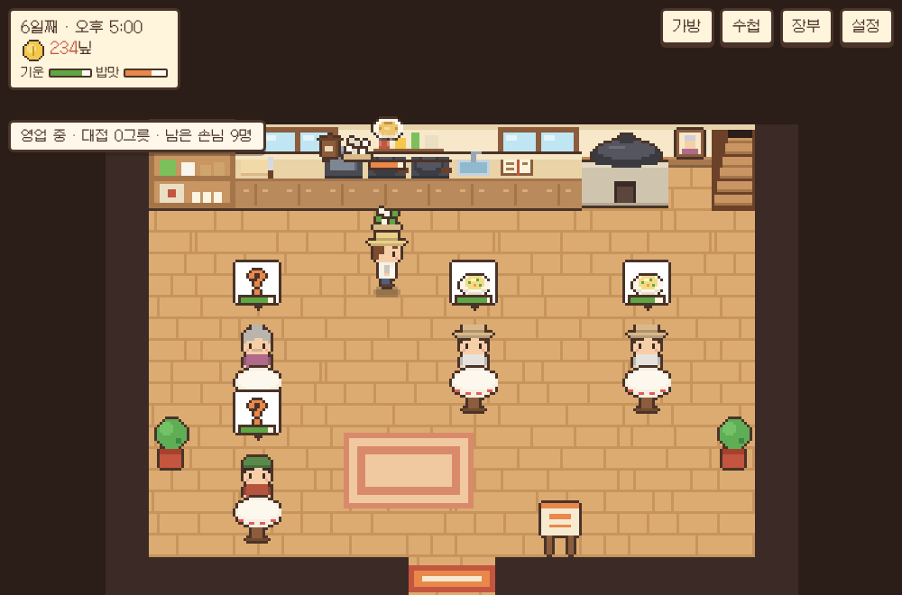
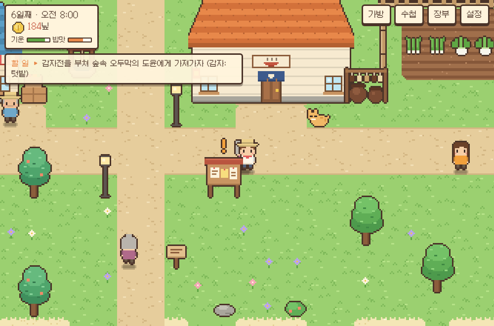
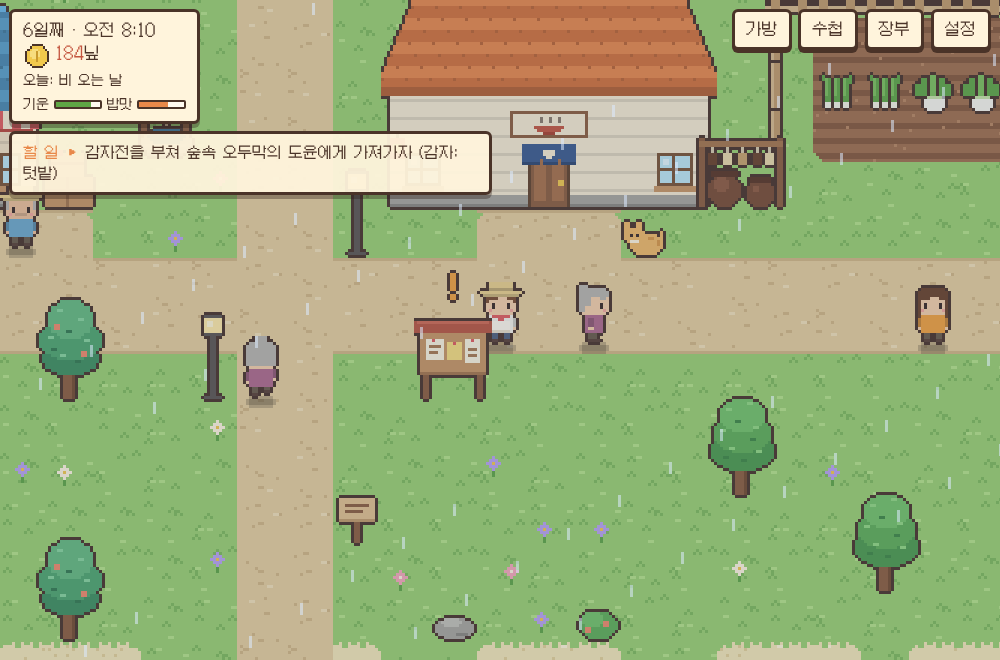
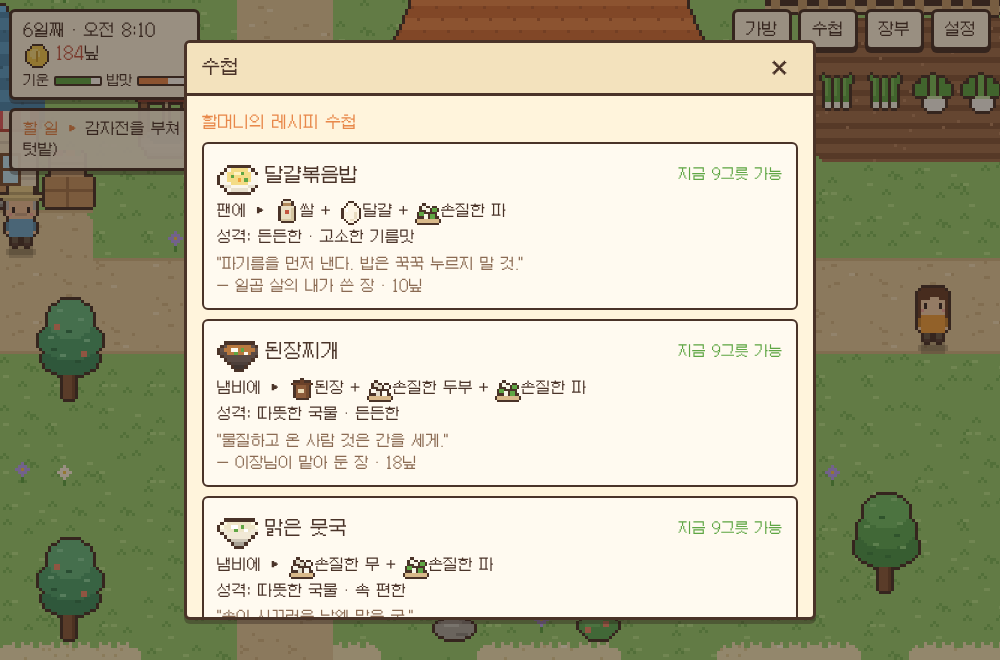
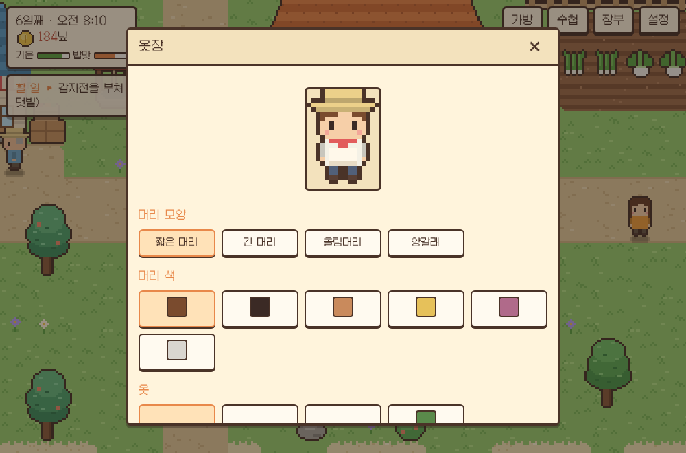
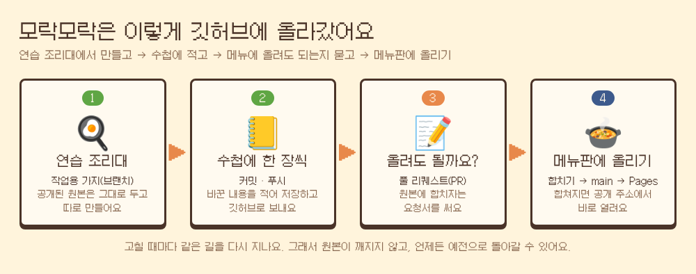

# 모락모락 — 솥골 식당 이야기

요리를 주제로 한 픽셀 힐링 시뮬레이션 게임. 이 저장소의 GitHub Pages 주소를 열면 바로 시작해요.



## 움직이는 화면

| 낮: 재료 구하고 마을 일 돕기 | 저녁: 식당 영업 |
| --- | --- |
|  |  |

## 사진으로 보기

| 마을에 도착 | 저녁 영업 |
| --- | --- |
|  |  |

| 낮의 마을 | 비 오는 날 |
| --- | --- |
|  |  |

| 레시피 수첩 | 옷장 |
| --- | --- |
|  |  |

## 깃허브에 올라간 길



<details>
<summary>글로 자세히 보기</summary>

- **이야기**: 번아웃으로 도시 주방을 떠난 주인공이 할머니가 남긴 '모락식당'을 물려받아요. 레시피 수첩은 뜯겨 있고, 할머니는 그 장들을 마을 사람들에게 한 장씩 맡겨 두었어요. 한 그릇씩 대접하며 레시피와, 30년 전 끊긴 '모락국밥'의 사연을 되찾는 1부 「식은 솥」.
- **하루의 흐름**: 낮에는 텃밭·숲·바닷가에서 재료를 구하고 → 저녁에는 식당을 열어 손님 주문을 요리하고 → 2층에서 자면 다음 날.
- **경영과 성장**: 대접할수록 평판이 쌓여 식당 별(1~5성)이 오르고, 손님 수·팁이 늘어요. 번 돈으로 도윤의 목공소에서 식탁·화구를 늘리고 칼·화구를 강화해요. 남는 재료와 요리는 만물상에 팔 수 있어요.
- **나의 손맛 · 나만의 요리**: 다섯 가지 손맛(불맛 장인, 국물 장인, 날랜 손, 살가운 주인, 알뜰한 살림꾼) 중 하나를 고르고, 조리도구와 재료를 직접 골라 이름 붙인 메뉴를 만들어 팔아요.
- **살림의 변수**: 이장님의 마을금고(예금 이자, 대출과 이자), 아침마다 가끔 생기는 '오늘의 일'(비, 장날, 관광버스, 풍어, 풍작, 물가 변동, 미식가 방문).
- **가공·다른 고장**: 식당 옆 건조대에서 재료를 하룻밤 말려 비싼 재료로 만들고, 버스 정류장에서 윗마을 농장·읍내 장터·건넛섬에 다녀오며 그 고장의 재료·레시피·옷을 구해요. 농장과는 납품 계약을 맺을 수 있어요.
- **옷장·게시판**: 가방의 옷장에서 머리·옷·모자를 바꾸고, 길가 게시판에서 주민들의 의뢰를 해결해요. 마을에는 주민들이 오가요.
- **몸 상태(기운·밥맛)**: 일을 하면 기운이 빠지고, 내가 만든 요리로 끼니를 챙기면 기운과 밥맛이 올라요. 밥맛이 좋으면 요리 값이 오르고 나쁘면 떨어져요. 마을 사람과 같이 먹으면 밥맛이 더 크게 올라요. 옷과 모자에는 저마다 작은 효과가 있어요.
- **사정이 있는 손님**: 가끔 요리 이름 대신 "감기 기운이 있어요", "종일 굶었어요" 같은 사정을 말하는 손님이 와요. 수첩에 적힌 요리의 성격(따뜻한 국물, 속 편한, 든든한 …)을 보고 어울리는 한 그릇을 골라 내면 값과 평판이 올라요.
- **같이 먹는 밥**: 마을 사람과 자주 마주 앉을수록 그 사람의 속 얘기가 한 토막씩 열려요.
- **현실 시간**: 자리를 비운 사이에도(8시간까지) 건조대가 마르고, 텃밭이 자라고, 기운이 돌아와요. 만들어 둔 요리는 소리나 이장님에게 맡기고 켜 둔 채 구경만 해도 팔려요. 장부에 문 연 날과 함께한 시간이 쌓여요.
- **별손님 홈스테이 (이 게임의 중심)**: 둘째 날 저녁부터 인형 같은 외계인 별손님이 식당 2층에 머물며 나를 졸졸 따라다녀요. 이 마을의 한 해는 40일, 계절마다 10일씩 다른 별에서 손님이 와요 — 봄 은하, 여름 보리, 가을 모모, 겨울 이로. 궁금해하는 요리를 가르쳐 주고, 같이 먹고, 같이 걸으면 정(♥)이 쌓이고, 하트마다 손님의 속 이야기가 열려요. ♥2부터 손질을, ♥3부터 채집을 거들고, ♥4로 배웅하면 선물을 남겨요. 할머니 이야기(1부)는 손님과 지내며 나란히 진행돼요.
- **레시피 도감**: 손님들이 오는 길에 들른 지구의 나라(이탈리아·태국·인도·멕시코) 이야기와 재료를 가져와요. 단서를 보고 부엌에서 재료를 조합해 **요리를 직접 찾아내면** 도감과 메뉴에 올라요. 찾은 요리를 서로 다른 손님에게 가르칠수록 별이 올라요(★ 실제 2인분 레시피 · ★★ 요령 · ★★★ 변주). 도감에는 별손님 앨범도 있어요.
- **도전 과제**: 「장부」에서 평판·살림·도전 과제를 확인해요.
- **조작**: 화면을 누르면 걸어가고, 사람·물건·조리대를 누르면 다가가서 써요. 키보드는 방향키/WASD + 스페이스.
- **기술**: 빌드 없이 도는 순수 HTML/JS. 그림과 소리는 전부 코드로 생성(이미지·음원 파일 없음). 글꼴은 [Galmuri](https://github.com/quiple/galmuri) (SIL OFL 1.1).

</details>

| 파일 | 내용 |
| --- | --- |
| `js/story.js` | 대본·퀘스트 목표 (글만 고치려면 여기) |
| `js/data.js` | 재료·레시피·가격·등장인물 생김새 |
| `js/art.js` | 픽셀 아트 (타일·캐릭터·아이콘·건물) |
| `js/audio.js` | 효과음·배경 음악 합성 |
| `js/game.js` | 엔진 (지도·이동·요리·영업·저장) |

로컬에서 보려면 저장소 폴더에서 `python3 -m http.server` 실행 후 `http://localhost:8000/`.

## 휴대 게임기에서 하기

게임 패드(조이스틱)를 지원해요. 안드로이드 레트로 휴대 게임기, 스팀덱, 블루투스·USB 컨트롤러를 연결한 태블릿이나 PC에서 버튼으로 할 수 있어요.

| 버튼 | 하는 일 |
| --- | --- |
| 십자 버튼 · 왼쪽 스틱 | 걷기 / 메뉴 안에서 고르기 |
| A | 살펴보기·말 걸기·대화 넘기기·고른 것 누르기 |
| B | 닫기·물러나기 |
| X / Y | 가방 / 수첩 |
| START / SELECT | 장부 / 설정 |

1. 게임기의 브라우저(크롬)로 GitHub Pages 주소를 열어요.
2. 메뉴 → **홈 화면에 추가**(또는 앱 설치)를 눌러요.
3. 홈 화면의 모락모락 아이콘으로 열면 주소창 없이 전체 화면으로 열려요.
4. 한 번 열어 두면 인터넷이 없어도 이어서 할 수 있어요.

## 연재 화 만들기

별손님 한 명 = 지구의 나라 하나 = 찾아낼 요리 몇 가지가 한 화예요. 한 화는 파일 하나예요.

1. `js/episodes/_template.js`를 복사해 `js/episodes/ep5-나라.js`처럼 만들어요.
2. 별손님 이름·생김새·대사·소문 단서, 나라 이야기, 새 재료, 요리(단서·실제 레시피·요령·변주·그림)를 채워요.
3. `js/episodes/index.js`의 `EPISODES` 목록에 한 줄 추가해요.

한 해(40일)에 네 화씩 봄·여름·가을·겨울 순서로 손님이 와요. 다섯 번째 화부터는 두 번째 해에 와요. 재료 이름이 틀렸거나 다른 요리와 재료 조합이 겹치면 `npm test`가 알려 줘요.

## 별의 소문 (큰 줄기 미스터리)

별손님들은 모두 우주에 떠도는 소문 「지구의 솥골, 김이 오르는 집」을 듣고 와요. 왜 이런 소문이 퍼졌는지가 게임 전체를 꿰는 수수께끼예요.

| 단서를 얻는 곳 | 언제 |
| --- | --- |
| 손님이 도착할 때 들려주는 소문 | 손님을 맞이하면 |
| 손님이 털어놓는 이야기 | 정 ♥2, ♥4가 되면 |
| 마을 곳곳(버스 시간표, 할머니 사진, 할머니 수첩) | 단서를 3·6·9개 모은 뒤 다시 살펴보면 |

단서 5·10·15개마다 이야기가 한 장씩 풀려요. 모은 단서는 도감 맨 위 「별의 소문」에서 볼 수 있고, 새로 시작해도 이어져요.

- 이야기(마을 단서, 장 줄거리): `js/mystery.js`
- 손님별 단서: 각 화 파일의 `visitor.clues` (`arrive`, `h2`, `h4`)

지금 들어 있는 줄거리는 임시예요. 위 두 곳만 고치면 미스터리 전체를 바꿀 수 있어요.

## 저장

- 진행은 기기에 자동 저장돼요. 하루를 마칠 때마다 전날 저장을 백업으로 남겨, 저장이 깨지면 백업으로 열려요.
- 설정 → **어제 아침으로 되돌리기**, **백업 코드**(복사해 두었다가 다른 기기에서 붙여 넣기).
- 저장 형식이 바뀌면 `js/game.js`의 `SAVE_VERSION`을 올리고 `MIGRATIONS`에 변환을 하나 더해요. 오래된 저장도 차례로 변환돼요.

## 자동 테스트

```bash
npm install
npx playwright install chromium   # 처음 한 번
npm test                           # 전체 (1부 전체 플레이 포함, 몇 분 걸려요)
npm test -- world                  # 이름에 world가 들어간 테스트만
```

| 테스트 | 확인하는 것 |
| --- | --- |
| `01-story` | 1부를 처음부터 엔딩까지 실제로 플레이 |
| `02-homestay` | 별손님, 도감 별 오르기, 한 해 끝 선택, 도감 이어받기 |
| `03-world` | 단서·재료·부엌에서 요리 찾아내기 |
| `04-gamepad` | 게임 패드만으로 조작 |
| `05-save` | 옛 저장 옮기기, 깨진 저장 → 백업, 백업 코드, 새로 시작 |
| `06-episodes` | 화 파일마다 레시피·단서·그림·대사가 빠지지 않았는지 |

## 토스 앱(앱인토스)에 올리기

**`store/toss/`** 폴더의 `.ait` 파일이 앱인토스에 올리는 묶음이에요. 콘솔에 등록한 appName과 이름이 같은 파일 하나를 올리면 돼요.

1. [앱인토스](https://toss.im/apps-in-toss) 콘솔에서 워크스페이스를 만들고 앱을 등록해요. **appName은 `morak-sikdang`** 으로 맞춰요. 이미 쓰이고 있으면 `sotgol-sikdang`, `morakmorak-cooking` 순서로 써요.
2. 게임이라서 **등급분류 정보**를 콘솔에 입력해야 해요.
3. 앱 등록 화면에서 같은 이름의 `.ait`를 올리고 검수를 요청해요. 입력 문구와 이미지는 `store/앱등록-내용.md`에 있어요.

콘솔에 다른 앱 이름으로 등록했다면 `apps-in-toss.config.mjs`의 `appName`을 그 이름으로 고친 뒤 다시 묶어야 해요.

```bash
npm install
npm run build:toss   # dist/ 에 게임 파일을 모으고 <앱이름>.ait 를 만들어요
```

| 파일 | 내용 |
| --- | --- |
| `apps-in-toss.config.mjs` | 앱 이름, 권한(없음), 화면 설정(당겨서 새로고침·밀어서 뒤로 가기 끔) |
| `tools/build-toss.mjs` | 게임 파일(`index.html`, `js/`, `fonts/`)만 `dist/`에 모으기 |
| `store/toss/*.ait` | appName 후보별로 만든 업로드용 묶음 |

---

# 함께 들어 있는 것: 여행 수첩 앱 (`heuksim/`)

이 저장소에 먼저 있던, 연필로 쓰는 여행 수첩 앱이에요. 지금은 `heuksim/` 폴더로 옮겨 두었고, Pages 주소 뒤에 `/heuksim/`을 붙이면 열려요. 게임 안 설정에서도 열 수 있어요.

- 30장짜리 가죽 수첩 한 권을 쓰고, 다 쓰면 책장에 날짜별로 눕혀 둬요.
- HB~8B 흑연 연필과 색연필, 야광 색연필을 직접 만들고 깎아서 써요.
- 사진과 메모지를 붙이고, 장을 넘기고, 한 장씩 이미지로 공유할 수 있어요.
- 한 번 열어 두면 인터넷이 없어도 써져요.

### 아이패드에 설치하기

1. Safari로 이 저장소의 GitHub Pages 주소 뒤에 `/heuksim/`을 붙여 열어요.
2. 공유 버튼 → **홈 화면에 추가**를 눌러요.
3. 홈 화면의 수첩 아이콘으로 열면 앱처럼 화면 전체로 열려요.

### 업데이트

새 버전이 올라오면 앱 아래에 "새 버전이 준비됐어요"가 떠요. **지금 바꾸기**를 누르면 쓰던 장을 저장한 뒤 새 버전으로 다시 열려요.

### 저장과 백업

수첩은 이 기기의 Safari 저장소에만 저장돼요. 설정 → **백업 저장**으로 파일을 받아 두고, 다른 기기나 새로 설치한 앱에서는 **백업 불러오기**로 옮겨요.
